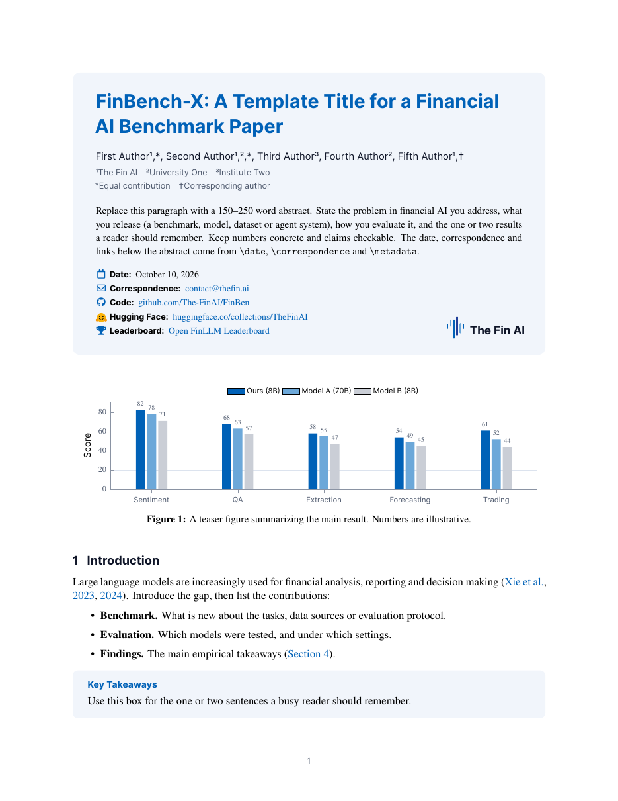

# The Fin AI arXiv template

[](https://www.overleaf.com/docs?snip_uri=https://github.com/The-FinAI/arxiv-template/releases/latest/download/thefinai-arxiv.zip)
[](https://github.com/The-FinAI/arxiv-template/actions/workflows/build.yml)
[](https://github.com/The-FinAI/arxiv-template/releases/latest/download/main.pdf)
[](LICENSE)

A LaTeX template for [The Fin AI](https://thefin.ai) papers on arXiv: technical reports, benchmark papers and preprints. The layout follows the header-card style used by many industry reports on arXiv and Hugging Face Papers, in The Fin AI's colors, logo and fonts.

<p align="center"></p>

## Quick start

- **Overleaf:** click **Open in Overleaf** above. A new project opens with the template, ready to edit. Keep the compiler on **pdfLaTeX** (Menu → Compiler).
- **Local:** `latexmk -pdf main.tex` with TeX Live 2023 or newer. Every push is compiled with pdfLaTeX by [GitHub Actions](https://github.com/The-FinAI/arxiv-template/actions).

| File | What it is |
|---|---|
| `thefinai.sty` | The style: title card, logo, headings, tables, callout boxes, plot palette |
| `main.tex` | A filled-in example paper; replace the text |
| `references.bib` | Example bibliography (PIXIU, FinBen, MultiFinBen, Fino1) |

## Title card

Everything above the first section sits in one tinted card: title, authors, abstract, then date, correspondence and links, with the logo in the bottom-right corner. **Put the abstract before `\maketitle`** so it lands inside the card.

```latex
\title{Your Title}
\date{October 10, 2026}
\reportlabel{Technical Report}      % optional small label above the title

\author{First Author\textsuperscript{1,*}, Second Author\textsuperscript{2,\dag}}
\affiliation[1]{The Fin AI}
\affiliation[2]{Your University}
\authornote{\textsuperscript{*}Equal contribution}
\authornote{\textsuperscript{\dag}Corresponding author}

\correspondence{\href{mailto:you@thefin.ai}{you@thefin.ai}}
\metadata[Code]{\ghlink{The-FinAI/YourRepo}}
\metadata[Hugging Face]{\hflink{collections/TheFinAI/...}}
\metadata[Leaderboard]{\href{https://huggingface.co/spaces/TheFinAI/...}{Leaderboard name}}

\begin{document}
\begin{abstract} ... \end{abstract}
\maketitle
```

These `\metadata` labels get their own icon: Code, Hugging Face, Data, Models, Leaderboard, Demo, Website, Project Page, Blog, Paper. Any other label gets a link icon.

## Package options

```latex
\usepackage[numbers]{thefinai}    % numeric citations [1] instead of (Author et al., 2026)
\usepackage[anonymous]{thefinai}  % hide authors, affiliations and links (blind review)
\usepackage[review]{thefinai}     % line numbers
\usepackage[nologo]{thefinai}     % no logo in the title card
```

## Building blocks

| Command | Use |
|---|---|
| a `figure` right after `\maketitle` | Teaser figure on page 1, as most current reports have |
| `\begin{takeaway} … \end{takeaway}` | Key takeaways box |
| `\begin{finding}{Finding 1.} … \end{finding}` | One empirical finding |
| `\begin{promptbox}[Prompt] … \end{promptbox}` | Prompts and model outputs, in monospace |
| `\oursrow` | Tinted table row for your method |
| `\best{…}`, `\second{…}` | Best and second-best results |
| `\up{2.1}`, `\down{0.4}` | Green/red deltas |
| `\begin{axis}[finai, …]` | pgfplots line charts in the brand palette |
| `\begin{axis}[finai,finaibars, …]` | Bar charts; the first series (your model) is the brand blue |
| `\thefinailogo[1em]`, `\thefinaiwordmark` | The logo (vector), alone or with the name |
| `\finai`, `\ghlink{org/repo}`, `\hflink{path}`, `\hficon` | Name, GitHub and Hugging Face links |

Colors you can use anywhere: `finaiink`, `finaiblue`, `finaideep`, `finailight`, `finaitint`, `finaicard`, `finaigold`, `finaisoft`, `finaimuted`.

## Submitting to arXiv

1. On Overleaf use **Submit → Submit to arXiv**, or download the source (Menu → Download → Source). The `thefinai-arxiv.zip` on the [releases page](https://github.com/The-FinAI/arxiv-template/releases/latest) already includes `main.bbl`.
2. Include the generated `main.bbl`, because arXiv does not run BibTeX. Overleaf's arXiv export adds it for you.
3. Upload `thefinai.sty` together with `main.tex`. No font or image files are needed: the logo and the Hugging Face icon are drawn in TikZ.
4. Keep the `\pdfoutput=1` line at the top of `main.tex`. arXiv uses it to choose pdfLaTeX.
5. For a conference submission, use the venue's official template instead. This style is for arXiv and reports.
